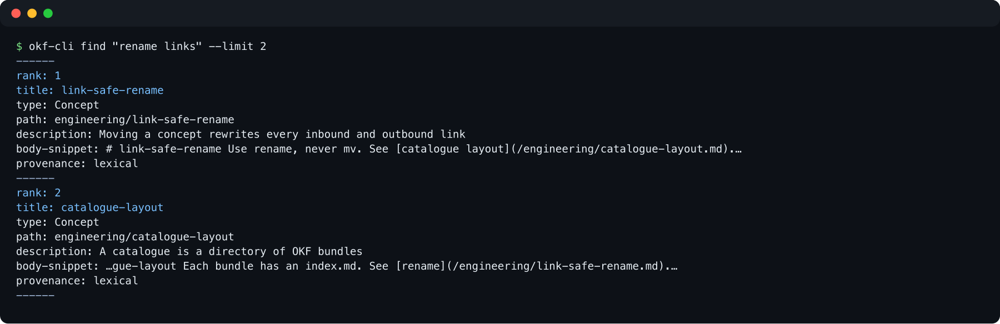

# okf-cli — CLI and MCP server for Open Knowledge Format (OKF) v0.2 catalogues

Search, navigate, validate and refactor a **catalogue of [Open Knowledge Format (OKF) v0.2](https://github.com/GoogleCloudPlatform/open-knowledge-format/blob/main/SPEC.md) bundles** — markdown files with YAML frontmatter, built for humans and AI agents.

- **Agent-ready.** `read` returns one section, or a page together with the pages it links to, in one call; one command registers an MCP server and an agent skill with Claude Code, Codex, opencode, omp, Kimi Code, OpenClaw and Hermes; `prime` onboards a fresh agent session in one call.
- **Predictable.** Every command answers `--json` with one envelope, and every failure has an exit code that names its class.
- **Hybrid search.** Local SQLite FTS5/BM25 plus optional semantic arm (Voyage embeddings), narrowed by one `--where` filter language.
- **Safe refactoring.** `rename` and `archive` move a concept and rewrite every inbound and outbound link. Every mutating command previews a unified diff before `--apply` writes it.
- **Trust and freshness.** OKF v0.2 provenance (`generated`, `sources`, `verified`, `stale_after`) is checked by `check`, recorded by `verify` and queried by `--where`.
- **Catalogue-aware.** Works across many bundles at once, not only one.

Keywords: Open Knowledge Format, OKF v0.2, knowledge base CLI, markdown frontmatter, MCP server, Claude Code, agent memory, Obsidian, BM25, link checker, wikilinks.

## Install

okf-cli is a single-file script with inline dependencies ([PEP 723](https://peps.python.org/pep-0723/)): Python 3.11 or newer, `ruamel.yaml` and `argcomplete`. [`uv`](https://docs.astral.sh/uv/) reads that header and installs the packages on first use, so install `uv` first. Run it from a clone, or install it as a tool. Both end in the same step, `okf-cli install`: it wires okf-cli into your coding agents and shells, and previews before it writes anything.

```bash
# From a clone: runs in place, `git pull` updates it
git clone https://github.com/xRiErOS/okf-cli && cd okf-cli
uv run --script cli/okf-cli.py install            # prints the plan, changes nothing
uv run --script cli/okf-cli.py install --apply    # performs it

# As a tool (Python >= 3.11)
pipx install git+https://github.com/xRiErOS/okf-cli      # or: uv tool install git+https://github.com/xRiErOS/okf-cli
okf-cli install
okf-cli install --apply
```

Then use it from any directory (run inside a catalogue root to drop `--root`):

```bash
okf-cli --root /path/to/catalogue prime          # agent onboarding
okf-cli --root /path/to/catalogue find "query"   # ranked search
okf-cli --root /path/to/catalogue check          # conformance scan
```

From a clone without `install`, `uv run --script cli/okf-cli.py --root … <command>` works the same. Details of what `install` writes, and how to undo it: [agents and shells](#use-with-ai-agents-and-shells).

## What is OKF?

[Open Knowledge Format](https://github.com/GoogleCloudPlatform/open-knowledge-format) is a vendor-neutral format from Google Cloud: knowledge as plain markdown files with YAML frontmatter in a directory hierarchy, linked by normal markdown links, indexed by generated `index.md` files. Version 0.2 adds provenance and freshness signals in frontmatter (`sources`, `generated`, `verified`, `status`, `stale_after`). A directory of such files is a *bundle*.

New to OKF? Read the [annotated guide on okf.md](https://okf.md/spec/) (community walkthrough, still labelled v0.1) first; the normative text is the [v0.2 SPEC.md](https://github.com/GoogleCloudPlatform/open-knowledge-format/blob/main/SPEC.md).

`okf-cli` treats a directory of bundles as one **catalogue**:

```
catalogue/
├── bundle-a/
│   ├── index.md          # marker-bounded listing, generated by `reindex`; declares okf_version: "0.2"
│   └── concept.md        # frontmatter: type, title, description, tags, generated, …
├── bundle-b/
├── TYPES.md              # valid type vocabulary
└── PROPERTIES.md
```

A bundle is an immediate subdirectory not starting with `.` or `_`, except `_ctx/`, the context-bundle directory.

A v0.2 concept carries its trust signals in frontmatter. Only `type` is required; every other field is optional:

```yaml
---
type: Runbook
title: Restore the database
description: Steps to restore the primary from the nightly dump.
tags: [database, recovery]
generated:                    # who produced the text, and when
  by: human:erik
  at: 2026-09-01T08:00:00Z
sources:                      # where the facts come from
  - resource: https://wiki.example/db-restore
verified:                     # who checked it against the sources (written by `okf-cli verify`)
  - by: human:erik
    at: 2026-09-03T10:00:00Z
status: stable                # draft | stable | deprecated; absent means stable
stale_after: 2027-03-01T00:00:00Z
---
```

- `generated`, `verified[]` and `sources` are the provenance. An actor (`by`) is `human:<id>`, `process:<id>` or `<producer>/<version>`; every instant is an ISO 8601 datetime with an explicit offset.
- The **trust tier** is derived from `verified` alone: `unverified` (no entry with a `by`), `human-reviewed` (at least one `human:` actor) or `machine-confirmed` (entries, but no human).
- A concept is **stale** once `stale_after` has passed.
- The v0.2 rules of `check` run only in bundles whose root `index.md` declares `okf_version: "0.2"`. A catalogue moves to v0.2 with [`migrate`](#migrate-a-catalogue-to-v02).

## Demo

Ranked search over a catalogue:



Link-safe rename (dry-run) shows one unified diff per rewritten file, then the plan:

```
$ okf-cli rename notes/ref.md notes/reference.md
--- a/_ctx/demo.md
+++ b/_ctx/demo.md
@@ -10,4 +10,4 @@
 | 1 | pflicht | [notes (draft)](/b/notes (draft).md) |  |
 | 2 | pflicht | [intro](/intro.md) |  |
 | 3 | pflicht | [design](/notes/design.md) |  |
-| - | nachschlag | [ref](/notes/ref.md) | nur bei Bedarf |
+| - | nachschlag | [reference](/notes/reference.md) | nur bei Bedarf |
rename from notes/ref.md
rename to notes/reference.md
would move   notes/ref.md  ->  notes/reference.md
  inbound    _ctx/demo.md   /notes/ref.md  ->  /notes/reference.md
  ctx        demo (reference)
  reindex    notes
rename (dry-run): 1 inbound, 0 outbound link(s), 0 wikilink(s) (0 skipped-ambiguous), 1 bundle(s), 0 sync source(s). Re-run with --apply.
```

## Commands

`okf-cli --help` lists all commands; `okf-cli <command> --help` shows every option of one command. Both are generated from the parser, so this README carries no per-option reference: it names each command, then explains the modes you choose between. The table below uses the same four groups as `--help`.

| group | command | what it does |
|---|---|---|
| navigation | `prime` | one-shot onboarding: usage guide, command list, catalogue state, bundle overview |
| | `index` | catalogue overview, or one bundle's `index.md` |
| | `info` | print the schema docs `TYPES.md` and `PROPERTIES.md` |
| | `list` | the complete, unranked set of concepts a `--where` expression selects |
| | `recent` | the most recently created concepts, newest first (reads git history) |
| | `toc` | the headings of a concept |
| | `read` | print a concept: whole, one section, or with its link neighbours |
| | `ctx` | curated, ordered reading lists per topic (14 verbs) |
| | `visualize` | write a `viz.html` concept graph for a bundle |
| | `sync-export` | print a canonical block's payload |
| search | `find` | ranked hybrid search (lexical and semantic) |
| | `refs` | inbound and outbound markdown links of a file |
| | `build-index` | build the lexical FTS5 index |
| | `build-semantic-index` | build the semantic embeddings index |
| tags | `tags` | tag usage counts, fuzzy candidate search, the `TAGS.md` registry |
| | `merge-tags` | merge or rename tags across concepts |
| | `remove-tags` | remove tags from concepts |
| | `normalize-tags` | rewrite inline `tags: [...]` to YAML block-list form |
| maintenance | `check` | conformance scan with stable rule IDs and severities |
| | `verify` | record that a concept was checked against its sources |
| | `migrate` | migrate catalogue frontmatter to OKF v0.2 |
| | `rename` | move a concept and rewrite every link to it |
| | `archive` | move a concept into `_archive/`, or back |
| | `reindex` | regenerate the marker-bounded `index.md` listings |
| | `fix-crosslinks` | rewrite links to catalogue-root-absolute form |
| | `fix-xml-tags` | wrap `<tag>` placeholders in inline code |
| | `rewrite-path` | literal path-string rewrite across text files |
| | `wikilinks` | report Obsidian `[[wikilinks]]` and whether each resolves |
| | `sync-status` | drift report for materialised canon blocks |
| | `sync-insert` | materialise a canonical block in a consumer concept |
| | `sync-update` | re-materialise outdated consumer blocks |
| | `install` | register okf-cli with this machine's agents and shells |

### Output, `--json` and exit codes

Every command takes `--json`. Once the command runs, it prints exactly one envelope on stdout and nothing else. A usage error caught by the argument parser (missing argument, excluded option combination) exits 2 with its message on stderr and no envelope:

```json
{"command": "read", "ok": false, "data": null, "warnings": [], "error": {"kind": "not_found", "code": 3, "message": "not found: notes/nope"}}
```

| field | meaning |
|---|---|
| `command` | the command that ran |
| `ok` | `true` when the exit code is 0 |
| `data` | the result; its shape is per command. `null` when the command failed before it had a result; a failure that has a result (check findings, drift rows) still carries it |
| `warnings` | notes about the run, e.g. an absent index that made `find` fall back to a substring scan. Without `--json` they go to stderr |
| `error` | `null` on success, else `{kind, code, message}` |

The exit code equals `error.code`, and `error.kind` names the class. One class per outcome:

| code | `error.kind` | meaning | typical source |
|---|---|---|---|
| 0 | — | success | |
| 1 | `internal` | the command itself failed | missing `git` for `recent`, a blocked `install` step |
| 2 | `invalid_input` | the call is wrong | usage error, invalid `--where` expression, unusable option combination, ambiguous section heading |
| 3 | `not_found` | a named thing does not exist | concept, section or file |
| 4 | `non_conformant` | the catalogue breaks a rule | `check` found an error (with `--strict`: or a warning) |
| 5 | `drift` | something is out of date | `sync-status`, `sync-update`, `reindex --check` |

The MCP server forwards the same `data`, `warnings` and `error`; it never reads the exit code.

### Filter concepts with `--where`

`--where` is the only filter option. `list`, `recent`, `find`, `merge-tags`, `remove-tags` and `normalize-tags` take it; `list` requires it.

```bash
okf-cli list --where 'type = Runbook and tag != draft'      # type and tag comparison
okf-cli list --where 'path ~ notes/'                        # ~ means "contains"
okf-cli list --where 'tier = human-reviewed'                # trust tier
okf-cli list --where 'stale = true'                         # stale_after has passed
okf-cli list --where 'status in (draft, deprecated)'
okf-cli find "restore" --where '(type = Runbook or type = Guide) and tag = database'
okf-cli remove-tags draft --where 'path ~ archive-candidates/'
```

An expression is `field op value`; combine with `and`, `or`, `not` and parentheses. Operators: `=` `!=` `<` `<=` `>` `>=` `~`, and `field in (a, b)`.

| field | holds |
|---|---|
| `type`, `tag` | frontmatter `type`; any one of the tags |
| `path` | `<bundle>/<concept-id>` |
| `archived` | `true` or `false` |
| `tier` | `unverified`, `machine-confirmed` or `human-reviewed` |
| `stale` | `true` or `false` |
| `status` | `draft`, `stable` or `deprecated`; an absent `status` counts as `stable` |
| any frontmatter key | nested with dots (`generated.by`), through lists too (`verified.by`, `sources.resource`) |

Instants (`generated.at`, `verified.at`, `stale_after`, `usage_window.from`, `usage_window.to`, `sources.last_modified`) compare as points in time and need an explicit offset: `stale_after < 2026-10-01T00:00:00Z`. Quote a value that holds spaces or `+`: `title = 'a b'`. Archived concepts are hidden unless the expression names `archived`. A malformed expression exits with code 2 and names the position.

### Read a concept

`toc` shows headings first: the cheapest way to decide whether a page is worth reading. `read` has three independent ways to choose what comes back, plus one way to widen it:

```bash
okf-cli read notes/design                          # the whole page
okf-cli read notes/design --section Design         # one section
okf-cli read notes/design --frontmatter-only       # the frontmatter block, delimiters included
okf-cli read notes/design --body-only              # everything after the frontmatter
okf-cli read notes/design --follow 1               # the page and the pages it links to
okf-cli read notes/design --follow 2 --inbound --max-tokens 4000
okf-cli read notes/design --section Design --follow 1 --json
```

- **`--section HEADING`** prints the section from that heading up to the next heading of equal or higher level, sub-sections included. Matching is case-insensitive and exact. `A > B` finds `B` inside `A`. An unknown heading exits with code 3; a heading that matches more than once exits with code 2.
- **`--frontmatter-only`** and **`--body-only`** split the page at the frontmatter block.
- **`--follow N`** adds the concepts the page links to, up to `N` hops deep, as one block (breadth-first, every page once). Each page is headed `===== depth <n> <concept> =====`; in `--json` the block is `data.nodes`, each with `path`, `depth`, `reduced`, `tokens` and `text`; a node with `reduced: true` carries `title` and `description` instead of `text`. With `--section`, only the starting page is narrowed.
- **`--inbound`** (with `--follow`): the pages that link to a page count as its neighbours too.
- **`--max-tokens K`** (with `--follow`): keep the block within `K` tokens (estimated as characters / 4). The starting page always prints in full; from the first page that no longer fits, pages show title and description only (`reduced: true`).

`--section`, `--frontmatter-only` and `--body-only` exclude each other. `--follow` combines with `--section`, never with `--frontmatter-only` or `--body-only`. `--inbound` and `--max-tokens` take effect only together with `--follow`. The MCP tool `okf_read` takes the same options.

### Search

`find` fuses two arms.

- **Lexical:** FTS5/BM25 over `<root>/.fts/fts.sqlite`, built by `build-index`. Local, no network. Without the index, `find` falls back to a substring scan and says so.
- **Semantic:** `<root>/.tagvec/tag_vectors.sqlite`, built by `build-semantic-index`. Needs `VOYAGE_API_KEY` and network. Without it the arm is skipped and `find` says so.

Indexes are built, not live. A changed catalogue makes `find` print a staleness note. `build-index --if-stale` and `build-semantic-index --if-stale` skip the work when the index is current.

```bash
okf-cli find "restore database"                       # ranked results, default 10
okf-cli find "restore" --limit 3 --where 'type = Runbook'
okf-cli find "restore" --breakdown                    # which arm and which score produced each hit
okf-cli find "restore" --json
```

Every hit leads with `rank: N`, its position in the delivered list. That is the one scale comparable across both arms. The raw scores (`a/100` for BM25, `cosine X.XX` for the semantic arm) are not comparable with each other and show only with `--breakdown`. `--where` narrows the candidates before the result is cut to `--limit`. `--include-topics` widens the search beyond the bundles declared in `.okf.toml` to topic folders. `--expand-tags` adds semantically near registered tags to the query; it stays off by default because it did not help on the real catalogue.

### Overview and onboarding

- `prime` prints the usage guide, the command list and the state of this catalogue (indexes, tag vocabulary, bundles). `--compact` lists bundles as one-liners, `--full` adds types and tags per bundle, `--check-semantic` runs the exact content-hash check of the semantic index.
- `index` lists the bundles with one-line descriptions; `index <bundle>` prints that bundle's `index.md`; `--full` prints the structured summary (description, concept count, directories, types, tags).
- `info` prints `TYPES.md` and `PROPERTIES.md`: the valid types and properties of this catalogue.
- `list --where …` returns the complete, unranked set; `recent` returns the newest concepts by git creation date, `--limit` caps it.

### Context bundles

`ctx` lists curated, ordered reading lists per topic (`_ctx/<slug>.md`); `ctx <slug>` is short for `ctx show <slug>`. An entry has a mode: `pflicht` (read it) or `nachschlag` (look it up when needed). The verbs:

| verb | does |
|---|---|
| `list`, `show` | list the bundles with entry counts; one bundle in reading order with live metadata and token estimates |
| `read`, `toc` | the full content of every `pflicht` entry; the headings of every entry |
| `create`, `add`, `drop`, `move`, `edit` | build and change a bundle: from paths or an import file, one entry in, one entry out, reorder or change its mode, open in `$EDITOR` |
| `rename`, `remove` | rename a bundle and rewrite its inbound links; delete it and list files that still link to it |
| `inbound`, `outbound` | the files linking to each entry; the links each entry points to |
| `check` | validate the bundles |

### Links and references

- `refs <file>` lists the inbound and outbound markdown links of a file; `--in` or `--out` shows one direction, `--scan-root` widens the scan beyond the catalogue.
- `wikilinks` reports Obsidian `[[wikilinks]]` and whether each resolves; `--unresolved` lists only the unresolved and ambiguous ones.
- `visualize <bundle>` writes a `viz.html` concept graph (needs network for its two JavaScript libraries); `--out` sets the path.

### Check conformance

`check` scans for the §9 hard rules, the OKF v0.2 rules and local invariants. Every finding has a stable **rule ID** and a **severity** (`error` or `warning`):

```
WARNING  kc/type/registered   notes/bad.md  (type `Bogus` not registered in TYPES.md)
```

Rule IDs start with `okf/` (the format itself, e.g. `okf/trust/verified`, `okf/lifecycle/stale-after`, `okf/trust/drift`) or `kc/` (catalogue conventions, e.g. `kc/link/crosslink-format`, `kc/type/registered`). With `--json`, the findings are `data.findings` with `rule`, `severity`, `path` and `message`.

```bash
okf-cli check                       # whole catalogue; exit 4 only for errors
okf-cli check notes                 # one bundle; notes/sub for a subdirectory
okf-cli check --strict              # warnings count toward the exit code too (exit 4 if any)
okf-cli check --ignore 'kc/tag/*' --ignore okf/lifecycle/stale-after
```

`--ignore` takes an exact rule ID or a prefix ending in `*`, and may repeat; it adds to the `ignore_rules` list in `.okf.toml`. A suppressed finding is neither printed nor counted. `okf/trust/drift` fires when the body changed in a git commit after `generated.at` without `generated.at` being updated; it needs git history.

### Record verification

`verify <concept> --by <actor>` appends an entry `{by, at}` to the concept's `verified` list, with the current UTC time. `--by` is `human:<id>`, `process:<id>` or `<producer>/<version>`. The tier follows from the actors: one `human:` entry makes the concept `human-reviewed`. `verify` rewrites only the frontmatter block.

```bash
okf-cli verify notes/ref --by human:erik
okf-cli list --where 'tier = human-reviewed'
```

### Preview, then apply

The commands that rewrite concept files preview first and show **one unified diff per affected file** (`--- a/<path>`, `+++ b/<path>`; a move starts with `rename from` / `rename to`). `--apply` writes exactly the previewed plan. With `--json` the diffs are `data.files`, each `{path, old_path, diff}`.

| default behaviour | commands | to write |
|---|---|---|
| previews, writes nothing | `rename`, `archive`, `migrate`, `merge-tags`, `remove-tags`, `normalize-tags`, `sync-insert`, `sync-update`, `install` | add `--apply` |
| writes immediately | `fix-crosslinks`, `fix-xml-tags`, `rewrite-path`, `reindex` | add `--check` to preview |

`verify`, the editing verbs of `ctx`, `tags --register` and the two index builders write immediately.

### Migrate a catalogue to v0.2

`migrate [<bundle>|<bundle>/<subdir>]` brings frontmatter to OKF v0.2:

- The old date field becomes `generated: {by, at}`. Time and author come from the git history of the file's last body change. Without such a commit the concept is reported as `unresolved`: its date field stays as it is and you resolve it by hand.
- `status` maps to the three v0.2 values: `obsolete`, `deleted`, `archived` become `deprecated`; `accepted`, `active`, `passive`, `stable` become `stable`; `todo`, `planned`, `in-bearbeitung`, `experimental` become `draft`. The old value is not kept; the preview prints the mapping and shows the loss in the diff.
- A citations list (heading `Citations`, `Quellen` or `Sources`) moves to `sources`. Content `migrate` cannot move safely (indented code, HTML blocks) is listed for manual rework.

```bash
okf-cli migrate notes                    # preview: the status mapping and one diff per file
okf-cli migrate notes --apply            # write exactly that
okf-cli check notes                      # v0.2 rules need okf_version: "0.2" in the bundle's index.md
```

`migrate` never writes without `--apply`. `generated` is edited by hand afterwards; no command regenerates it.

### Tags

`tags` prints every tag with its usage count; `tags <candidate>…` fuzzy-searches the existing tags for candidates, `--singletons` shows tags used once. `tags --register TAG "description"` adds a tag to the `TAGS.md` allow-list (closed vocabulary); `tags --validate TAG…` checks tags against it. `merge-tags a b --into c` merges or renames; `remove-tags` removes; `normalize-tags` rewrites inline `tags: [x, y]` to block-list form. The three editing verbs take `--where` and preview by default.

### Move, archive and repair

- `rename <old> <new>` moves a concept (same or other bundle) and rewrites every inbound and outbound link, unambiguous wikilinks and context-bundle entries, then reindexes. `--force` overwrites an existing destination and proceeds when inbound wikilinks would turn ambiguous.
- `archive <bundle>/<concept>` moves a concept to `_archive/<bundle>/`; `archive --restore _archive/<bundle>/<concept>` moves it back. The other end is derived, never typed.
- `reindex <bundle>` regenerates the marker-bounded listings: `index.md` for one level, `index-map.md` for the whole subtree. `--init` converts marker-less flat `index.md` files to managed ones; `--check` reports stale and uncovered listings (exit 5) without writing.
- `fix-crosslinks` rewrites links to the catalogue-root-absolute form (`/bundle/subdir/concept.md`); `--include-reserved` also covers `index.md`, `log.md` and the other reserved files outside their managed block.
- `fix-xml-tags` wraps `<tag>` placeholders in inline code.
- `rewrite-path <old> <new>` replaces a literal path string across text files, `--scan-root` sets the directory.

Use `rename` and `archive` instead of `mv` and `rm`: one commit then carries the move and every rewritten link.

### Canon blocks

A canonical concept declares addressable blocks; consumers carry copies and stay verifiably in sync. The relationship is derived by a catalogue walk, there is no index to go stale.

- `sync-export <concept> <block-id>` prints a block's payload.
- `sync-insert <consumer> <concept> <block-id>` materialises a block in a consumer concept (preview first).
- `sync-status [target]` reports each materialised block as `synced`, `source-changed`, `consumer-modified`, `both-changed`, `source-missing` or `malformed`; anything but `synced` exits 5. `--source` and `--block` narrow it.
- `sync-update [target]` re-materialises outdated copies (preview first); `--force` also overwrites a locally modified copy.

## Works with Obsidian

A catalogue is plain markdown with YAML frontmatter, so it opens as an [Obsidian](https://obsidian.md) vault unchanged: edit and browse in Obsidian, search, validate and refactor with `okf-cli`. `wikilinks` reports `[[wikilinks]]` and whether they resolve; `rename` also rewrites unambiguous wikilinks. To enforce OKF v0.2 inside Obsidian itself, see the [okf-enforcer](https://github.com/MartinForReal/okf-enforcer) plugin.

## Works with git

Git is the recommended way to distribute OKF bundles: markdown gives clean diffs, the commit log records who changed which concept, branches and PRs propose knowledge changes. `okf-cli` leaves version control to git. Use `rename` and `archive` instead of `mv`/`rm`, so one commit carries the move and every rewritten link.

## Use with AI agents and shells

`okf-cli install` finds the coding agents and shells on this machine and wires up each one. The plan lists every file first; `--apply` writes them; a second `--apply` changes nothing.

| Agent | Skill (`skills/okf`) | MCP server `okf` |
|---|---|---|
| Claude Code | `~/.claude/skills/okf` | `claude mcp add` at user level (else the key in `~/.claude.json`) |
| Codex | shared `~/.agents/skills/okf` | `codex mcp add` (else a marked block in `~/.codex/config.toml`) |
| opencode | shared | `mcp.okf` in `~/.config/opencode/opencode.json` |
| omp | shared | `mcpServers.okf` in `~/.omp/agent/mcp.json` |
| Kimi Code | shared | `mcpServers.okf` in `~/.kimi-code/mcp.json` |
| OpenClaw | shared | `openclaw mcp set` |
| Hermes | `~/.hermes/skills/okf` | marked block in `~/.hermes/config.yaml` |

The shared copy in `~/.agents/skills/okf` is read by Codex, opencode, Kimi Code, omp and OpenClaw, so it is installed once. The MCP server is registered as `uv run --with "mcp<2" <install dir>/mcp/okf_mcp.py`: `uv` must be on `PATH`, otherwise only the MCP step is blocked and the plan says how to fix it. The server offers 21 tools, each with `root` as first argument: `okf_find`, `okf_read` (with `section`, `follow`, `inbound` and `max_tokens`), `okf_toc`, `okf_index`, `okf_list`, `okf_check`, `okf_refs`, `okf_wikilinks`, `okf_tags`, `okf_prime`, `okf_info`, `okf_ctx_list`, `okf_ctx_show`, `okf_rename`, `okf_reindex`, `okf_build_index`, `okf_build_semantic_index` and the four `okf_sync_*` tools. Verbs not listed (`verify`, `migrate`, `archive`, the tag and repair verbs, `install`) stay CLI-only. The server is a thin subprocess wrapper that starts the CLI through `uv run --script` and returns its `--json` envelope as `{data, warnings}`, plus `error` when a failure still carries a result; all logic stays in the CLI. To register it by hand in any MCP client:

```json
{
  "mcpServers": {
    "okf": { "command": "uv", "args": ["run", "--with", "mcp<2", "/path/to/okf-cli/mcp/okf_mcp.py"] }
  }
}
```

### Shell PATH and completion

| Shell | TAB completion | rc change |
|---|---|---|
| zsh | `~/.zsh/completions/_okf-cli` | block in `${ZDOTDIR:-~}/.zshrc`: `fpath` and `compinit`, only where missing |
| bash | `~/.local/share/bash-completion/completions/okf-cli`, sourced from the rc block | `~/.bashrc`; on macOS the login file: the first of `~/.bash_profile`, `~/.bash_login`, `~/.profile` that exists, else `~/.bash_profile` |
| fish | `~/.config/fish/completions/okf-cli.fish` | `~/.config/fish/conf.d/okf-cli.fish` |

From a clone, `install` also creates `~/.local/bin/okf-cli` and puts `~/.local/bin` on `PATH` in that rc block (skipped when `okf-cli` is already on `PATH`, as after pipx or uv). Completion uses `argcomplete`, one of the script's declared dependencies; a normal run never imports it. TAB completes concept paths, bundles, tags and canon block ids from the catalogue (`okf-cli read <TAB>`). An alias must start with `okf-cli` (found via `PATH`), not an absolute path.

### How `install` behaves

- **Selection.** Agents and shells are detected by their binary on `PATH` or their config directory (shells: rc file, config directory or login shell). `--only claude,codex,zsh` names them explicitly, detected or not: `claude omp codex opencode kimi openclaw hermes zsh bash fish`.
- **Clone or tool.** A clone links the skills and the zsh glue, so `git pull` updates them. A pipx or uv install copies them: re-run `okf-cli install --apply` after an upgrade. Hermes, and OpenClaw with a custom `OPENCLAW_STATE_DIR`, always get copies.
- **Safe edits.** JSON configs get a key-scoped merge; rc files, TOML and YAML get one block between `# >>> okf-cli >>>` and `# <<< okf-cli <<<`. Writes are atomic, symlinked dotfiles are written through, and the first edit of a file keeps `<file>.okf-cli.bak`. A config that cannot be edited safely (JSON with comments, unusual YAML, a foreign `okf` entry) is reported as BLOCKED with the exact manual edit; nothing is guessed.
- **Uninstall.** `okf-cli install --uninstall` previews, `--uninstall --apply` removes exactly what `install` created.
- **Locations.** `CLAUDE_CONFIG_DIR`, `PI_CODING_AGENT_DIR`, `PI_CONFIG_DIR`, `CODEX_HOME`, `OPENCODE_CONFIG`, `XDG_CONFIG_HOME`, `XDG_DATA_HOME`, `KIMI_CODE_HOME`, `OPENCLAW_STATE_DIR`, `HERMES_HOME` and `ZDOTDIR` are honoured.
- **Scripting.** No prompts, no network, timeouts on every agent CLI call. `--json` prints one envelope `{command, ok, data, warnings, error}`; `data` holds a status per step. Exit code 0: done or nothing to do; 1: a step is blocked or failed; 2: usage error.
- **Platforms.** macOS and Linux, Python 3.11 or newer.

## How it differs

| | okf-cli | single-bundle tools |
|---|---|---|
| scope | catalogue of many bundles | one bundle |
| dependencies | declared inline (PEP 723), installed by `uv run --script` | varies |
| link-safe move/rename | yes | rarely |
| search | BM25 + semantic, local index | varies |

Catalogue-aware fork inspired by Cole Medin's single-bundle `okf-cli.py`. Related OKF projects: [open-knowledge-format](https://github.com/GoogleCloudPlatform/open-knowledge-format) (spec), [openknowledge-sh/openknowledge](https://github.com/openknowledge-sh/openknowledge), [okf-enforcer](https://github.com/MartinForReal/okf-enforcer) (Obsidian).

## Learn more

- [Google Cloud blog: How the Open Knowledge Format can improve data sharing](https://cloud.google.com/blog/products/data-analytics/how-the-open-knowledge-format-can-improve-data-sharing) — the original announcement
- [OKF v0.2 specification](https://github.com/GoogleCloudPlatform/open-knowledge-format/blob/main/SPEC.md) and [reference repository](https://github.com/GoogleCloudPlatform/open-knowledge-format)
- [okf.md](https://okf.md/) — community guide: [spec walkthrough](https://okf.md/spec/), [FAQ](https://okf.md/faq/), [tools](https://okf.md/tools/), [ecosystem map](https://okf.md/ecosystem-map/)
- [Karpathy's LLM Wiki gist](https://gist.github.com/karpathy/442a6bf555914893e9891c11519de94f) — the idea that inspired much of the ecosystem

## Development

```bash
just test     # unittest discovery over tests/test_*.py
just build    # wheel and sdist into dist/ (uv build)
just check    # conformance scan against a real catalogue
just prime
just setup    # the okf-cli install plan; add --apply to perform it
```

`just test` must be green before anything in `cli/`, `tests/` or `mcp/` is committed. Tests never write into a real catalogue. `just check` and `just prime` take a catalogue root as argument; their default is a personal catalogue path set at the top of the `justfile`.

`cli/okf-cli.py` is only the entry point: it carries the PEP 723 header, builds the parser, resolves the catalogue root and dispatches. The commands live in the `cli/okf/` package; tests live in `tests/`, and `tests/test_okf_cli.py` covers the entry itself. The `cli/_okf-cli` file is the zsh completion glue installed by `okf-cli install`; it stays beside the entry payload because packaging and installer tests verify that path.

- Shared foundation: `catalogue` (root, bundles, concepts, tags, configuration), `linkscan` (link and reference scan), `parser_support` (command registration helpers), `errors` (the exit-code classes), `output` (the `--json` envelope), `diffs` (unified-diff previews), `history` (git lookups for `recent`, `migrate` and the drift rule), `spec` (trust tier and staleness).
- Commands, each module defining its `COMMANDS`: `navigation` (list, read, info, toc, visualize, refs), `prime`, `index` (index, reindex), `ctx`, `recent`, `find` (with `find_filters`, the `--where` grammar), `fts` (build-index), `semantic` (build-semantic-index), `tags`, `check` (check, fix-crosslinks, fix-xml-tags; the v0.2 rules are in `spec_check`), `verify`, `migrate`, `wikilinks`, `sync`, `rename` (rename, archive, rewrite-path) and `install`.
- `parser` merges the `COMMANDS` of every command module into the argparse parser; `entry_support` holds the BrokenPipe helper of the entry.

## Contributing

See [CONTRIBUTING.md](CONTRIBUTING.md). Spec changes go upstream to [open-knowledge-format](https://github.com/GoogleCloudPlatform/open-knowledge-format).

## License

[Apache-2.0](LICENSE)
