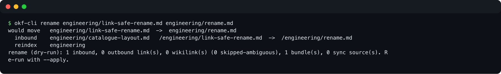

# okf-cli — CLI and MCP server for Open Knowledge Format (OKF) v0.2 catalogues

Search, navigate, validate and refactor a **catalogue of [Open Knowledge Format (OKF) v0.2](https://github.com/GoogleCloudPlatform/open-knowledge-format/blob/main/SPEC.md) bundles** — markdown files with YAML frontmatter, built for humans and AI agents.

- **Zero install.** One Python file, standard library only. No pip, no build.
- **Hybrid search.** Local SQLite FTS5/BM25 plus optional semantic arm (Voyage embeddings).
- **Safe refactoring.** `rename` and `archive` move a concept and rewrite every inbound and outbound link.
- **Agent-ready.** MCP server with 15 tools; `prime` onboards a fresh agent session in one call.
- **Catalogue-aware.** Works across many bundles at once, not only one.

Keywords: Open Knowledge Format, OKF v0.2, knowledge base CLI, markdown frontmatter, MCP server, Claude Code, agent memory, Obsidian, BM25, link checker.

## Quick start

```bash
git clone https://github.com/xRiErOS/okf-cli && cd okf-cli
python3 cli/okf-cli.py --root /path/to/catalogue prime          # agent onboarding
python3 cli/okf-cli.py --root /path/to/catalogue find "query"   # ranked search
python3 cli/okf-cli.py --root /path/to/catalogue check          # conformance scan
```

Run inside the catalogue root to drop `--root`. Requires Python 3.

## What is OKF?

[Open Knowledge Format](https://github.com/GoogleCloudPlatform/open-knowledge-format) is a vendor-neutral format from Google Cloud: knowledge as plain markdown files with YAML frontmatter in a directory hierarchy, linked by normal markdown links, indexed by generated `index.md` files. Version 0.2 adds provenance and freshness signals in frontmatter (`sources`, `generated`, `verified`, `status`, `stale_after`). A directory of such files is a *bundle*.

`okf-cli` treats a directory of bundles as one **catalogue**:

```
catalogue/
├── bundle-a/
│   ├── index.md          # marker-bounded listing, generated by `reindex`
│   └── concept.md        # frontmatter: type, title, description, tags, timestamp
├── bundle-b/
├── TYPES.md              # valid type vocabulary
└── PROPERTIES.md
```

A bundle is an immediate subdirectory not starting with `.` or `_`.

## Demo

Ranked search over a catalogue:


Link-safe rename (dry-run) rewrites the inbound link in another concept:



## Commands

`okf-cli.py --help` lists all commands; `okf-cli.py <command> --help` shows options. Both are generated from the parser, so this README carries no hand-maintained list.

| purpose | commands |
|---|---|
| navigation | `index` · `info` · `list` · `recent` · `toc` · `read` · `ctx` |
| search | `find` · `tags` · `build-index` · `build-semantic-index` |
| integrity | `check` · `refs` · `wikilinks` · `log` |
| mutation | `rename` · `archive` · `reindex` · `merge-tags` · `remove-tags` · `normalize-tags` |
| repair | `fix-crosslinks` · `fix-xml-tags` · `rewrite-path` |
| output | `visualize` |

`rename` and `archive` are dry-run by default; add `--apply`.

### Search

`find` fuses two arms.

- **Lexical:** FTS5/BM25 over `<root>/.fts/fts.sqlite`, built by `build-index`. Local, no network.
- **Semantic:** `<root>/.tagvec/tag_vectors.sqlite`, built by `build-semantic-index`. Needs `VOYAGE_API_KEY` and network. Without it the arm is skipped and `find` says so.

Indexes are built, not live. A changed catalogue makes `find` print a staleness note.

### Context bundles

`ctx` lists curated, ordered reading lists per topic (`_ctx/<slug>.md`); `ctx <slug>` shows one.

## Use with AI agents (MCP)

```json
{
  "mcpServers": {
    "okf": { "command": "python3", "args": ["/path/to/okf-cli/mcp/okf_mcp.py"] }
  }
}
```

15 tools, one per CLI verb, each with `root` as first argument. Works with any MCP client (Claude Code, Codex, Cursor, …). The server is a thin subprocess wrapper; all logic stays in the CLI.

## Shell completion (zsh)

```bash
just setup    # installs argcomplete, links cli/_okf-cli into ~/.zsh/completions
```

`okf-cli find x --type <TAB>` completes types, tags, scopes, concept refs and canon block ids from the catalogue. `argcomplete` is optional; a normal run never imports it. An alias must start with `okf-cli` (found via `PATH`), not an absolute path.

## How it differs

| | okf-cli | single-bundle tools |
|---|---|---|
| scope | catalogue of many bundles | one bundle |
| dependencies | none (stdlib) | varies |
| link-safe move/rename | yes | rarely |
| search | BM25 + semantic, local index | varies |

Catalogue-aware fork inspired by Cole Medin's single-bundle `okf-cli.py`. Related OKF projects: [open-knowledge-format](https://github.com/GoogleCloudPlatform/open-knowledge-format) (spec), [openknowledge-sh/openknowledge](https://github.com/openknowledge-sh/openknowledge), [okf-enforcer](https://github.com/MartinForReal/okf-enforcer) (Obsidian).

## Development

```bash
just test     # unittest discovery over cli/test_*.py
just check    # conformance scan against a real catalogue
just prime
```

`just test` must be green before anything in `cli/` or `mcp/` is committed. Tests never write into a real catalogue.

## License

[Apache-2.0](LICENSE)
