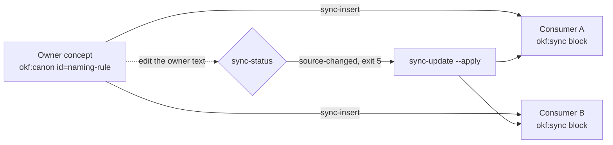

# Canon blocks: sync a shared rule across markdown concepts

**Write a rule once in its owner concept. okf copies it into other concepts and tells you when a copy drifts.**

The measured version is okf 0.2.4 (`git describe`: `rel-0-2-4-115-g91f54bf`). The runs below use a throwaway copy of the test catalogue.

## How it looks

`okf sync-status` lists every copy of a canon block and its state. Here the owner text changed after one copy was made:

```text title="okf sync-status"
$ okf --root <catalogue> sync-status
synced             handbook/ops/setup.md            /kc-gov/ownership.md#ownership-rule
source-changed     kc-gov/naming.md                 /kc-gov/ownership.md#naming-rule
sync-status: 1 synced, 1 source-changed, 0 consumer-modified, 0 both-changed, 0 source-missing, 0 malformed
[exit 5]
```

Exit 5 means drift was found. After `okf sync-update --apply` every copy is `synced` and the exit code is 0:

```text title="okf sync-update --apply, then sync-status"
$ okf --root <catalogue> sync-update --apply
--- a/kc-gov/naming.md
+++ b/kc-gov/naming.md
@@ -9,8 +9,8 @@
-<!-- okf:sync id=naming-rule source=/kc-gov/ownership.md hash=68dca574d22c -->
+<!-- okf:sync id=naming-rule source=/kc-gov/ownership.md hash=5f1068e89974 -->
 > [!quote] Synchronisiert aus `/kc-gov/ownership.md` — Canon-Owner, hier nicht bearbeiten.
 <!-- okf:sync-body -->
-Names are lowercase, hyphenated and stable.
+Names are lowercase, hyphenated, stable and unique.
 <!-- /okf:sync -->
updated        kc-gov/naming.md   /kc-gov/ownership.md#naming-rule
sync-update: 1 updated, 0 refused, 0 unresolvable.
[exit 0]
$ okf --root <catalogue> sync-status
synced             handbook/ops/setup.md            /kc-gov/ownership.md#ownership-rule
synced             kc-gov/naming.md                 /kc-gov/ownership.md#naming-rule
sync-status: 2 synced, 0 source-changed, 0 consumer-modified, 0 both-changed, 0 source-missing, 0 malformed
[exit 0]
```

## Why it matters

**Edit the canon once and every consumer follows.** You do not search for copies of a rule by hand.

## What you get



- [`okf sync-export`](/reference/commands/okf-sync-export/) prints the payload of one canon block.
- [`okf sync-insert`](/reference/commands/okf-sync-insert/) materialises a canon block in a consumer concept.
- [`okf sync-status`](/reference/commands/okf-sync-status/) reports the state of every copy.
- [`okf sync-update`](/reference/commands/okf-sync-update/) re-materialises outdated copies from their owner.

`okf rename` and `okf archive` of an owner rewrite `source=` in all its sync blocks (see [Safe edits](/features/safe-edits/)).

## Details

### Marker syntax

The owner concept declares a canon block between two comments:

```markdown title="kc-gov/ownership.md (owner)"
<!-- okf:canon id=ownership-rule -->
Every normative statement has exactly one owner.
<!-- /okf:canon -->
```

A consumer concept holds the managed copy, a sync block. It carries the owner path in `source=` and a 12-hex `hash=`:

```markdown title="handbook/ops/setup.md (consumer)"
<!-- okf:sync id=ownership-rule source=/kc-gov/ownership.md hash=594970cbf139 -->
> [!quote] Synchronisiert aus `/kc-gov/ownership.md` — Canon-Owner, hier nicht bearbeiten.
<!-- okf:sync-body -->
Every normative statement has exactly one owner.
<!-- /okf:sync -->
```

Do not edit the text between `okf:sync-body` and `/okf:sync`. The next `sync-update` replaces it.

### Insert and update preview first

The argument order of `sync-insert` is consumer, owner concept, block id. Without `--apply` okf prints a diff and writes nothing:

```text title="okf sync-insert"
$ okf --root <catalogue> sync-insert handbook/glossary kc-gov/ownership naming-rule
--- a/handbook/glossary.md
+++ b/handbook/glossary.md
@@ -14,3 +14,9 @@
 ## Concept
 
 One Markdown file with frontmatter.
+
+<!-- okf:sync id=naming-rule source=/kc-gov/ownership.md hash=5f1068e89974 -->
+> [!quote] Synchronisiert aus `/kc-gov/ownership.md` — Canon-Owner, hier nicht bearbeiten.
+<!-- okf:sync-body -->
+Names are lowercase, hyphenated, stable and unique.
+<!-- /okf:sync -->
would insert    handbook/glossary.md   /kc-gov/ownership.md#naming-rule
sync-insert (dry-run): re-run with --apply.
```

`sync-update` takes an optional target (`<bundle>` or `<bundle>/<subdir>`), `--source` and `--block` to narrow the blocks, and `--force` to discard local edits of a consumer.

### Drift states

`sync-status` reports one of: `synced`, `source-changed`, `consumer-modified`, `both-changed`, `source-missing`, `malformed`. The `okf check` rules `kc/sync/block`, `kc/sync/canon-block` and `kc/sync/stale` cover the same blocks (see [Conformance checks](/features/conformance-checks/)).

## Limits

- The statuses `consumer-modified`, `both-changed`, `source-missing` and `malformed` are listed by okf; this page shows only runs with `synced` and `source-changed`.
- After an owner `rename --apply`, the `> [!quote]` line of a consumer still names the old path until `sync-update` runs. Observed: `source=` is rewritten at once, the quote line is not. The status stays `synced` because the payload did not change.
- Only one error path was run: `sync-insert` with a concept argument that does not exist prints `not found: naming-rule` and exits 3. Other exit codes of `sync-insert` and `sync-update` are not verified. TODO: verify

## Reference

- [`okf sync-export`](/reference/commands/okf-sync-export/), [`okf sync-insert`](/reference/commands/okf-sync-insert/)
- [`okf sync-status`](/reference/commands/okf-sync-status/), [`okf sync-update`](/reference/commands/okf-sync-update/)
- [Canon block](/reference/glossary/#canon-block) in the glossary
