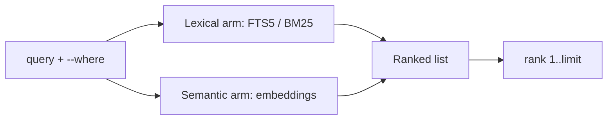

## Markdown knowledge base search with `okf find`

**Run `okf find` and get ranked concepts from the shell, narrowed by one `--where` filter. Add the semantic arm when you want embeddings.**

The output below comes from okf 0.2.5, run against a throwaway copy of the test catalogue.

## How it looks

Without an index, `find` falls back to a substring scan and says so on stderr. Build the FTS5 index once, then ask again:

```text title="Build the index, then search"
$ okf build-index
indexed 25 concept(s) -> <catalogue>/.fts/fts.sqlite
[exit 0]
$ okf find recipe --limit 2
note: semantic arm skipped (.tagvec cache/concept embeddings absent) — lexical results only
------
rank: 1
title: Recipes overview
type: Concept
path: recipes/overview
description: Overview of the recipes
body-snippet: # Overview See [pasta](pasta.md), [bread](/okf-cli/recipes/bread.md), [soup](soup.md) and [[salad]].…
provenance: lexical
------
rank: 2
title: cooking
type: Context
path: _ctx/cooking
description: Cooking basics
body-snippet: …| |---|---|---|---| | 1 | pflicht | [bread](/okf-cli/recipes/bread.md) | | | 2 | pflicht | [pasta](/okf-cli/recipes/pasta.md) | | | 3 | pflicht | [soup](…
provenance: lexical
------
[exit 0]
```

Every hit carries `rank`, its 1-based position in the list, and `provenance`, the arm that produced it. Add `--breakdown` to see the raw score per hit:

```text title="okf find recipe --limit 2 --breakdown (score lines only)"
score: 100/100
contrib: bm25 (fts5 index; field-level breakdown not available)
score: 88/100
contrib: bm25 (fts5 index; field-level breakdown not available)
```

## Why it matters

**You get ranked hits without leaving the shell, and the same `--where` filter selects the same concepts for [`okf list`](/okf-cli/reference/commands/okf-list/).**

## What you get

- Ranked results from a SQLite FTS5 index with BM25 weights: title 3.0, tags 2.0, body 1.0.
- An optional semantic arm that ranks by embedding similarity.
- One `--where` expression that narrows by type, tag, path, archived state and any frontmatter key. See the [`--where` reference](/okf-cli/reference/where-filter/).
- `okf list` returns the complete, unranked set that a `--where` selects.

```text title="okf find recipe --where 'type = Recipe' --limit 1"
------
rank: 1
title: Soup
type: Recipe
path: recipes/soup
description: Tomatensuppe
body-snippet: …weis Use a pot <size>. Compare with [bread](/okf-cli/recipes/bread.md).…
provenance: lexical
------
[exit 0]
```

```text title="okf list --where 'tag = soup'"
------
title: Gazpacho
type: Recipe
path: recipes/seasonal/gazpacho
description: Cold tomato soup
------
title: Soup
type: Recipe
path: recipes/soup
description: Tomatensuppe
------
list: 2 concept(s)
[exit 0]
```

The filter applies before the cut to `--limit`. Archived concepts stay hidden unless the expression names `archived`.

## How the two arms work



The list order is the rank. The two arms never blend scores: the arm that owns the ranking hands over its order. Raw scores stay out of the default output. `--breakdown` prints them, one `score:` line per hit.

## Details

- `okf build-index` builds or refreshes `.fts/fts.sqlite`. `--if-stale` skips the rebuild when the index is current. The file shows as untracked in git.
- Without the index, `find` scans substrings and prints `note: lexical index absent — falling back to substring scan; run `okf build-index` for BM25 ranking`. Hits then print `provenance: lexical`, not `substring` as the help says [gnnc].
- The semantic arm reads `.tagvec/tag_vectors.sqlite`. `okf build-semantic-index` fills it with `voyage-3-large` embeddings and needs `VOYAGE_API_KEY`. The tag commands use a local Ollama `bge-m3` at `localhost:11434` (see [Tags and registry](/okf-cli/features/tags-and-registry/)). The endpoint and model are fixed today; a configurable endpoint is planned [76eb].
- When the semantic data is absent, `find` prints `note: semantic arm skipped (.tagvec cache/concept embeddings absent) — lexical results only` and the lexical result stands alone. Degradation never changes the exit code.
- `okf recent` lists the newest concepts and takes the same `--where`.
- `--include-topics` widens the search from the `.okf.toml` bundle to topic folders.
- `--json` prints one envelope. `data` holds `hits` and `nearest_tags`; degradation notes arrive in `warnings`.

## Limits

- `build-semantic-index` without `VOYAGE_API_KEY` exits 0 and writes nothing. It prints `note: semantic index build skipped (VOYAGE_API_KEY not set)`. Check the exit code and the note, not only success.
- `--expand-tags` is off by default. The project measured it as ineffective for the vocabulary mismatch it targets.
- The semantic arm was not run for this page. Its behaviour with a key is read from the code, not from a run.

## Reference

- [`okf find`](/okf-cli/reference/commands/okf-find/)
- [`okf list`](/okf-cli/reference/commands/okf-list/)
- [`okf recent`](/okf-cli/reference/commands/okf-recent/)
- [`okf build-index`](/okf-cli/reference/commands/okf-build-index/)
- [`okf build-semantic-index`](/okf-cli/reference/commands/okf-build-semantic-index/)
- [`--where` filter](/okf-cli/reference/where-filter/)
