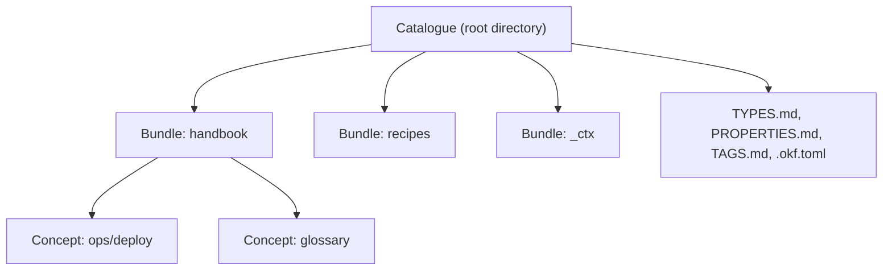

## OKF concepts: catalogue, bundle, concept and frontmatter

**After this page you can tell a catalogue from a bundle from a concept, and you know which frontmatter fields okf reads.**

Terms are defined once in the [glossary](/reference/glossary/). Examples come from the test catalogue of the okf repository, measured with okf 0.2.4.

## Catalogue, bundle, concept



- A **catalogue** is a directory: the root. okf finds it by `.okf.toml`, or by `SPEC.md` together with `TYPES.md`.
- A **bundle** is an immediate subdirectory of the root. Names that start with `.` or `_` are not bundles. `_ctx/` is the one exception: it holds the [context bundles](/features/context-bundles/). `_archive/` holds archived concepts and stays hidden from search and list unless you name it.
- A **concept** is a `.md` file in a bundle with YAML frontmatter. Its concept-id is its path below the bundle, without `.md`. The `path` in okf output is `<bundle>/<concept-id>`.

```text title="A catalogue on disk"
catalogue/
├── .okf.toml
├── SPEC.md
├── TYPES.md
├── PROPERTIES.md
├── TAGS.md
├── handbook/
│   ├── index.md
│   ├── glossary.md
│   └── ops/
│       └── deploy.md
├── recipes/
└── _ctx/
    └── onboarding.md
```

`handbook/ops/deploy.md` is the concept with bundle `handbook`, concept-id `ops/deploy` and path `handbook/ops/deploy`.

Four file names are reserved and are not concepts: `index.md`, `log.md`, `readme.md` and `index-map.md`. They never carry `type`. Files that are not Markdown belong under `assets/`.

## Specification-first

:::note[okf follows the specification]
okf implements the Open Knowledge Format (OKF) specification. okf-cli follows the specification and is adapted when it changes. This page promises no release date and no release for each specification version.
:::

The `okf_version` key in the `index.md` at the root of a bundle selects the rules. The test catalogue declares `okf_version: "0.2"`. Specification repository: TODO: verify (URL not in the sources of this documentation).

## Types and frontmatter

Every concept starts with a YAML frontmatter block. `type` is the one required field. The catalogue lists the valid types in `TYPES.md` and the properties in `PROPERTIES.md`. `okf info` prints both.

```text title="handbook/ops/incident-2026.md"
---
type: Note
title: "Incident 2026"
description: A past incident
tags:
  - incident
stale_after: 2026-01-05T00:00:00Z
---

# Incident 2026

## Timeline

Short timeline.
```

| Field | Meaning |
|---|---|
| `type` | Required, not empty, registered in `TYPES.md`. |
| `title`, `description` | Display title and one-line summary. |
| `tags` | Tags registered in `TAGS.md`, in block-list form. |
| `status` | `draft`, `stable` or `deprecated`. No `status` means stable. |
| `generated` | Provenance of the content: `by`, `at`. `by` must not be empty. |
| `sources` | List of sources, each with a `resource`. |
| `verified` | List of review entries `{by, at}`. `okf verify` writes them. |
| `stale_after` | Instant after which the concept counts as stale. |
| `superseded_by` | Replacement concept. For Decision concepts only. |

The full field list with the check rule of each field is in [Frontmatter and types](/reference/frontmatter-and-types/).

## Provenance and freshness

OKF v0.2 adds four provenance fields: `generated`, `sources`, `verified` and `stale_after`.

- `okf check` reports problems. A `stale_after` in the past is a warning: `okf/lifecycle/stale-after`. A `generated` without `by` is an error: `okf/trust/generated`.
- `okf verify` records a review in `verified`. The reviewer is `human:<id>`, `process:<id>` or `<producer>/<version>`.
- The trust tier follows from `verified` only: `unverified` (no entry with a `by`), `human-reviewed` (at least one `human:<id>`), otherwise `machine-confirmed`. The `--json` output of `list`, `find`, `read` and `recent` shows `tier` and `stale`.

The v0.2 rules apply in bundles whose root `index.md` declares `okf_version: "0.2"`. TODO: verify what `okf check` does in a bundle without `okf_version`.

## Context bundles, tags, canon blocks

- **Context bundle.** A file `_ctx/<slug>.md` with `type: Context`. It lists concepts in reading order, each one *required* or *reference*. See [Context bundles](/features/context-bundles/).
- **Tags.** `TAGS.md` is the tag registry. `okf check` warns about a tag that is not registered. See [Tags and registry](/features/tags-and-registry/).
- **Canon block.** A marked block in a concept that mirrors text owned by one other concept. `okf sync-*` keeps the copies equal. See [Canon blocks](/features/canon-blocks/).

## Search and index artefacts

okf writes two optional caches inside the catalogue:

- `.fts/fts.sqlite`: the lexical (BM25) index. `okf build-index` writes it. It holds title, tags and body of each concept.
- `.tagvec/tag_vectors.sqlite`: tag and concept embeddings for the semantic arm. `okf build-semantic-index` writes it. Embeddings come from Voyage (needs `VOYAGE_API_KEY`) or from Ollama with `bge-m3` on `localhost:11434`.

Neither file is part of your content. In a git repository both show as untracked. See [Search](/features/search/).

## Reference

- [Glossary](/reference/glossary/)
- [Frontmatter and types](/reference/frontmatter-and-types/)
- [First steps](/overview/first-steps/): run the commands on a test catalogue
