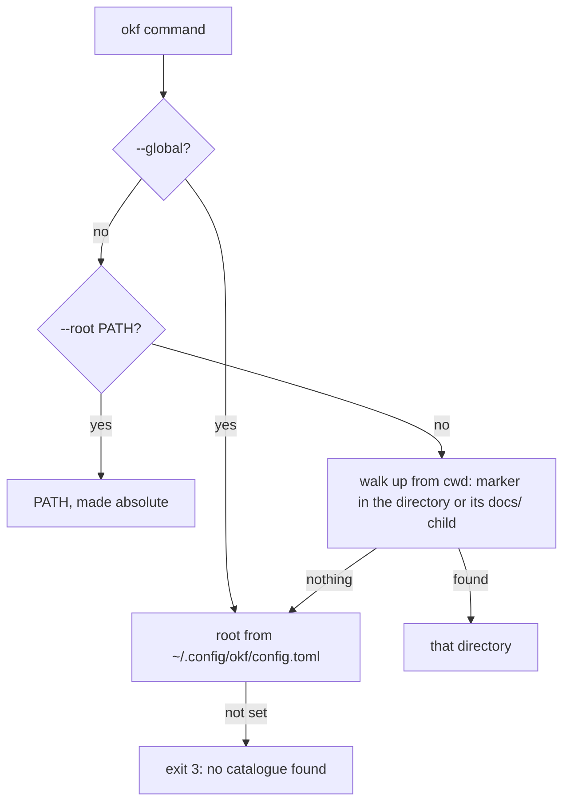

# okf configuration: `.okf.toml` and `config.toml`

okf has two optional config files and a short list of environment variables. Both files are TOML. For terms such as *root* and *bundle* see the [Glossary](/reference/glossary/).

## Root resolution order

Every command needs a catalogue root. okf picks it in this order and stops at the first hit:



1. `--global`: use `root` from the user config, whatever lies above the working directory. `--global` together with `--root` is an error (exit 2: `--global and --root exclude each other`). Without a configured `root` the exit code is 3.
2. `--root PATH`: a leading `~` is expanded and the path is made absolute. A directory that does not exist is exit 3 (`root not found`).
3. The nearest catalogue above the working directory. In each directory okf tests the directory itself and its `docs/` child for a marker. A marker is `.okf.toml`, or `SPEC.md` together with `TYPES.md`. The `docs/` child lets you run okf from a repository whose catalogue lives in `<workspace>/docs`.
4. `root` in the user config.

When nothing is found, okf exits 3:

```text
$ (no user config, cwd=/tmp) okf list ...

[stderr]
ERROR: no catalogue found in cwd or its ancestors and no root in /tmp/okf-facts/home/.config/okf/config.toml; pass --root <path>
[exit 3]
```

:::note
`--root` and `--global` are options of `okf` itself. Put them before the command: `okf --root /path find git`.
:::

## Config files

| File | Scope | Keys |
|---|---|---|
| `<root>/.okf.toml` | one catalogue | `bundle`, `types_source`, `ignore_rules`, `registry_format`, `wikilink_checked_bundles`, `[git_authors]` |
| `~/.config/okf/config.toml` | the user | `root` |

### `.okf.toml`

| Key | Type | Effect |
|---|---|---|
| `bundle` | string | Names the one real bundle among scaffolding directories. Narrows index and search to it. |
| `types_source` | path | Location of `TYPES.md`. `okf check --types` overrides it. |
| `ignore_rules` | list | Rule ids that `check` skips. An entry ending in `*` is a prefix. |
| `registry_format` | `"table"` or `"block"` | Form that `okf tags --register` writes. Any other value is exit 2: `registry_format must be "table" or "block"`. |
| `wikilink_checked_bundles` | list | Bundles in which wikilinks are checked. |
| `[git_authors]` | table | Maps an e-mail address to an actor (`human:<id>`). [`okf migrate`](/reference/commands/okf-migrate/) uses it. |

Example:

```toml title=".okf.toml"
registry_format = "table"
wikilink_checked_bundles = ["handbook"]
ignore_rules = ["kc/asset/entry-file-description"]

[git_authors]
"golden@example.org" = "human:golden"
```

### `~/.config/okf/config.toml`

The only key is `root`: an absolute path or a path that starts with `~/`.

```toml title="~/.config/okf/config.toml"
root = "~/knowledge"
```

A relative value is exit 2:

```text
ERROR: /tmp/okf-facts/home/.config/okf/config.toml: root must be an absolute path or start with ~/
[exit 2]
```

With this file set, a command run from any directory finds the catalogue (step 4 above), and `--global` forces it even inside another catalogue.

## Environment variables

| Variable | Read by | Effect |
|---|---|---|
| `XDG_CONFIG_HOME` | okf | Moves the user config to `$XDG_CONFIG_HOME/okf/config.toml`. A relative value is ignored. Default: `~/.config`. |
| `VOYAGE_API_KEY` | `okf build-semantic-index` | API key for the Voyage embeddings (`voyage-3-large`). Without it the command exits 0 and writes nothing. A CI job cannot detect a missing key from the exit code. |
| `COLUMNS` | `okf --help` and command help | Width for wrapping help text, when it is a positive integer. |
| `OKF_BIN` | the MCP server | Path of the `okf` binary the server runs. Any non-empty value is used as is. Otherwise the server tries `<package>/bin/okf`, then `<package>/go/bin/okf`, then `okf` on `PATH`. |
| `OKF_MCP_MAX_CHARS` | the MCP server | Output ceiling, default `120000`. A longer result is an error that asks the caller to narrow the call. |

Embeddings come from two places today: the Voyage API (`voyage-3-large`, needs `VOYAGE_API_KEY`) and a local Ollama server with `bge-m3` at `http://localhost:11434/api/embed` (1024 dimensions). The endpoint, model and key are not configurable.

## Files okf writes

| Path | Written by | Content |
|---|---|---|
| `<root>/.fts/fts.sqlite` | `okf build-index` | Lexical search index (SQLite FTS5). Git shows it as untracked unless you ignore it. |
| `<root>/.tagvec/tag_vectors.sqlite` | `okf build-semantic-index`, `okf tags --register` | Tag and concept vectors for the semantic arm. |
| `<root>/_ctx/*.md` | `okf ctx create` and the other ctx verbs | One ctx bundle per file. |
| `index.md`, `index-map.md` in a bundle | `okf reindex` | Listing between `<!-- okf:index -->` markers. Text outside the markers is kept. |

`okf install` is a dry run until you pass `--apply`. With `--apply` it writes under `$HOME`:

- the agent skill: `~/.claude/skills/okf` (Claude), `~/.agents/skills/okf` (Codex and omp), `~/.hermes/skills/okf`, `~/.openclaw/skills/okf`;
- an MCP registration for each detected agent (for Claude through `claude mcp add`, for omp in `~/.omp/agent/mcp.json`);
- shell completion: `~/.zsh/completions/_okf` plus a managed block in `.zshrc`; for bash `${XDG_DATA_HOME:-~/.local/share}/bash-completion/completions/okf`; for fish `$XDG_CONFIG_HOME/fish/completions/okf.fish`;
- a wrapper `~/.local/bin/okf`, only for a source checkout when `okf` is not on `PATH`.

`okf install --uninstall --apply` removes what install created. See [`okf install`](/reference/commands/okf-install/).
