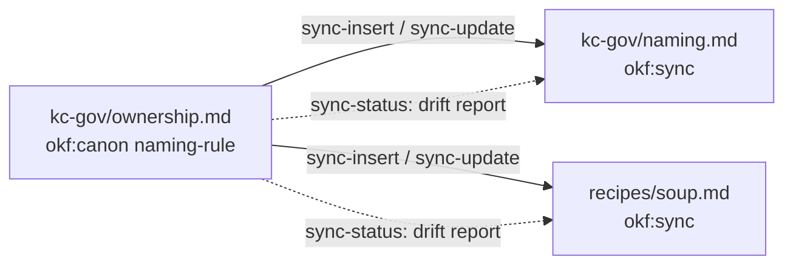

import { Steps, Aside, LinkCard, CardGrid } from '@astrojs/starlight/components';

# Define canon knowledge: reusable rules across projects with okf sync

**Define a rule once and every project concept that carries it holds the same text.** The output below comes from okf 0.2.4 (`git describe`) on a throwaway copy of the test catalogue.



## Set it up

Mark the rule in its owner concept. The owner holds the text; consumers get copies.

```markdown title="kc-gov/ownership.md"
<!-- okf:canon id=naming-rule -->
Names are lowercase, hyphenated, stable and unique.
<!-- /okf:canon -->
```

Put the catalogue under git so each change is one diff. Details of the markers: [Canon blocks](/okf-cli/features/canon-blocks/).

## Work through it

<Steps>

1. Print the payload without its markers:

   ```text title="okf sync-export"
   $ okf sync-export kc-gov/ownership naming-rule
   Names are lowercase, hyphenated, stable and unique.
   [exit 0]
   ```

2. Materialise it in a consumer concept. Without `--apply` it only previews:

   ```text title="okf sync-insert (dry run)"
   $ okf sync-insert recipes/soup kc-gov/ownership naming-rule
   --- a/recipes/soup.md
   +++ b/recipes/soup.md
   @@ -15,3 +15,9 @@
    ## Hinweis
    
    Use a pot <size>. Compare with [bread](/recipes/bread.md).
   +
   +<!-- okf:sync id=naming-rule source=/kc-gov/ownership.md hash=5f1068e89974 -->
   +> [!quote] Synchronisiert aus `/kc-gov/ownership.md` — Canon-Owner, hier nicht bearbeiten.
   +<!-- okf:sync-body -->
   +Names are lowercase, hyphenated, stable and unique.
   +<!-- /okf:sync -->
   would insert    recipes/soup.md   /kc-gov/ownership.md#naming-rule
   sync-insert (dry-run): re-run with --apply.
   [exit 0]
   ```

   With `--apply` the same block is written and the last line reads `inserted        recipes/soup.md   /kc-gov/ownership.md#naming-rule`.

3. Change the owner text later, then see which copies lag. `sync-status` reads only and exits 5 on drift:

   ```text title="okf sync-status"
   $ okf sync-status
   synced             handbook/ops/setup.md            /kc-gov/ownership.md#ownership-rule
   source-changed     kc-gov/naming.md                 /kc-gov/ownership.md#naming-rule
   synced             recipes/soup.md                  /kc-gov/ownership.md#naming-rule
   sync-status: 2 synced, 1 source-changed, 0 consumer-modified, 0 both-changed, 0 source-missing, 0 malformed
   [exit 5]
   ```

4. Refresh outdated copies. Dry run first, then `--apply`:

   ```text title="okf sync-update --apply"
   $ okf sync-update --apply
   --- a/kc-gov/naming.md
   +++ b/kc-gov/naming.md
   @@ -9,8 +9,8 @@
    
    Refer to [ownership](/kc-gov/ownership.md).
    
   -<!-- okf:sync id=naming-rule source=/kc-gov/ownership.md hash=68dca574d22c -->
   +<!-- okf:sync id=naming-rule source=/kc-gov/ownership.md hash=5f1068e89974 -->
    > [!quote] Synchronisiert aus `/kc-gov/ownership.md` — Canon-Owner, hier nicht bearbeiten.
    <!-- okf:sync-body -->
   -Names are lowercase, hyphenated and stable.
   +Names are lowercase, hyphenated, stable and unique.
    <!-- /okf:sync -->
   updated        kc-gov/naming.md   /kc-gov/ownership.md#naming-rule
   sync-update: 1 updated, 0 refused, 0 unresolvable.
   [exit 0]
   ```

</Steps>

### A copy edited by hand

`sync-update` refuses to overwrite a consumer copy that was edited. `--force` discards the local edit.

```text title="Consumer copy modified"
$ okf sync-status --source /kc-gov/ownership.md
synced             handbook/ops/setup.md            /kc-gov/ownership.md#ownership-rule
synced             kc-gov/naming.md                 /kc-gov/ownership.md#naming-rule
consumer-modified  recipes/soup.md                  /kc-gov/ownership.md#naming-rule
sync-status: 2 synced, 0 source-changed, 1 consumer-modified, 0 both-changed, 0 source-missing, 0 malformed
[exit 5]
$ okf sync-update --apply
refused        recipes/soup.md   /kc-gov/ownership.md#naming-rule  (consumer copy modified — reconcile into the canon owner first, or --force to discard)
sync-update: 0 updated, 1 refused, 0 unresolvable.
[exit 5]
```

<Aside type="caution">
`sync-update --apply --force` overwrites the local edit. If the edit is worth keeping, move it into the canon owner first.
</Aside>

An unknown block id stops `sync-insert` with exit 3:

```text title="Unknown block"
$ okf sync-insert --apply recipes/stew kc-gov/ownership nope
no canon block `nope` in kc-gov/ownership.md
[exit 3]
```

## What you get

Project concepts that carry the same canon text, and a drift report (`source-changed`, `consumer-modified`, …) whenever the owner or a copy changes. `okf check` also warns about an outdated copy (`kc/sync/stale`). Background and design: the blog post [Canon in the catalogue](/okf-cli/blog/canon-in-the-catalogue/).

## Limits

- After `rename --apply` of a canon owner, the `> [!quote]` line in consumers keeps the old path and `sync-status` can still say `synced` [6peo]. Run `okf sync-update --apply`.
- `sync-update` exits 5 when it refuses a block or cannot resolve one. The exit codes of `sync-insert` other than 0 and 3 are not verified. TODO: verify

## Reference

<CardGrid>
  <LinkCard title="Canon blocks" href="/okf-cli/features/canon-blocks/" />
  <LinkCard title="okf sync-export" href="/okf-cli/reference/commands/okf-sync-export/" />
  <LinkCard title="okf sync-insert" href="/okf-cli/reference/commands/okf-sync-insert/" />
  <LinkCard title="okf sync-update" href="/okf-cli/reference/commands/okf-sync-update/" />
</CardGrid>
