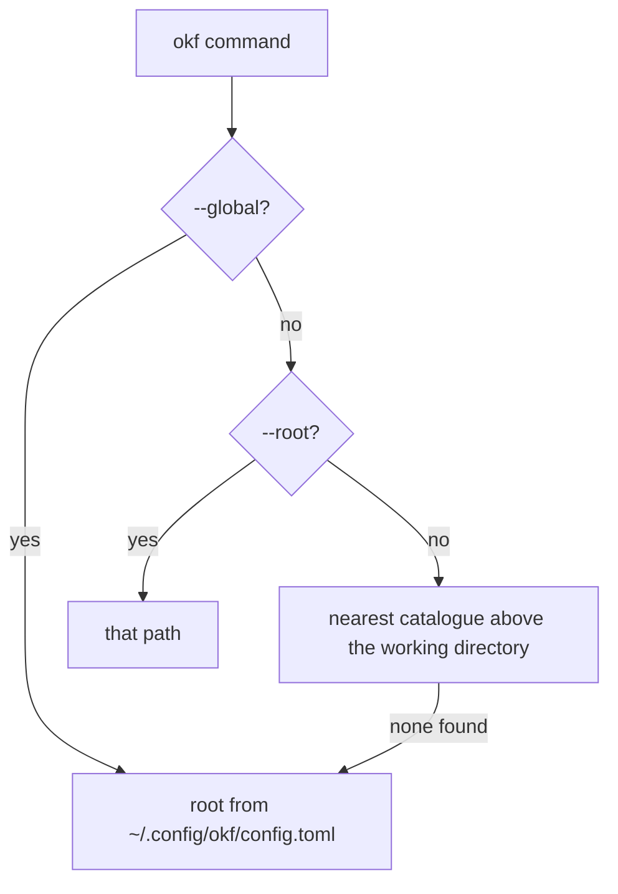

## Work with multiple knowledge bases

**One binary, any number of catalogues, chosen per call.**

Search terms covered: multiple knowledge bases CLI, `okf --root`, catalogue config, Obsidian vault CLI. Output below comes from okf 0.2.5 against two throwaway catalogues, `a` and `b`; `b` is a copy of `a` without the `recipes` and `kc-gov` bundles.

## Set it up

okf picks the catalogue in this order:



1. `--root <path>` uses that catalogue.
2. Otherwise okf walks up from the working directory and uses the nearest catalogue.
3. Otherwise it reads `root` from `~/.config/okf/config.toml`.
4. `--global` skips steps 1 and 2 and uses the config root.

```toml title="~/.config/okf/config.toml"
root = "~/knowledge"
```

Details and the `.okf.toml` marker: [Configuration](/okf-cli/reference/configuration/).

## Work through it

Run the same command against two roots:

```text title="okf --root a index"
_ctx: Curated, ordered reading lists per topic — one file per ctx slug, managed by `okf ctx`.
handbook: Welcome to the handbook.
kc-gov: 
recipes: 
```

```text title="okf --root b index"
_ctx: Curated, ordered reading lists per topic — one file per ctx slug, managed by `okf ctx`.
handbook: Welcome to the handbook.
```

Inside a catalogue you need no flag. From `a/handbook/ops`, `okf index` prints the catalogue `a`. With `root = "<path to b>"` in the config, `okf --global index` run from inside `a` prints the catalogue `b`.

Catalogue-wide commands such as `find`, `list`, `check` and `tags` span all bundles of one root. Narrow to one bundle with `--where "path ~ handbook/"`. See [Where filter](/okf-cli/reference/where-filter/).

## What you get

One command set across every catalogue: a private one, project ones and shared bundles. Agents use the same selection: the MCP tools take `root` and `use_global`, see [Agent onboarding](/okf-cli/overview/agent-onboarding/).

## Limits

- `--root` and `--global` go before the command and exclude each other:

  ```text title="okf --global --root b index"
  ERROR: --global and --root exclude each other
  [exit 2]
  ```

- `--global` without a configured `root` exits 3.
- One call uses one root. To search two catalogues, make two calls.

## Reference

- [Configuration](/okf-cli/reference/configuration/)
- [Concepts](/okf-cli/overview/concepts/)
